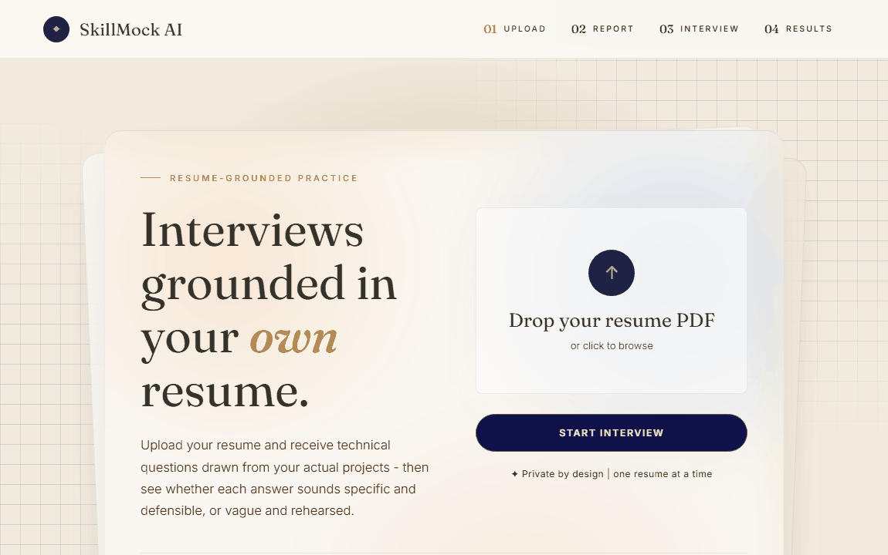

# SkillMock AI

Resume-grounded mock interviewer. Upload a resume, get technical questions built
from the actual claims in it, answer them, and see whether each answer sounds
specific and defensible or vague.

Most mock-interview tools ask generic questions ("tell me about a time you solved
a problem"). This one reads your resume first, so the questions are about the
projects you actually built.

## Demo



Upload a resume, read the ATS report, match it against a job description, then
answer resume-specific questions and get scored. A sample resume to try it with
is in [docs/sample_resume.pdf](docs/sample_resume.pdf).

## Stack

- **Frontend:** React (Create React App), plain CSS
- **Backend:** Flask
- **Embeddings:** `all-MiniLM-L6-v2` running locally on onnxruntime (fastembed)
- **Vector search:** FAISS
- **LLM:** Groq / Gemini free tier (swappable, with an offline mock provider)
- **Database:** MySQL (SQLite fallback for local runs)

## Flow

```
Upload  ->  Resume report  ->  Interview  ->  Results
```

1. **Upload** - PDF is validated, parsed, split into sections, embedded and indexed
2. **Report** - ATS scan, claim strength, company fit, optional job-description match
3. **Interview** - questions retrieved from your resume, calibrated to a role level
4. **Results** - per-answer scores with concrete suggestions

## Features

### Resume analysis
- **Section classifier** - labels Contact / Skills / Experience / Projects / Education,
  then only scores achievement bullets (Skills and Contact are never scored, which
  is how real ATS parsers behave)
- **Bullet extraction** - joins line-wrapped bullets, drops headers, dates, job
  titles and contact lines that PDF extraction leaves behind
- **Claim strength** - each bullet scored 0-1 on a signal-counting rubric
  (number / technology / action / scope) rather than a vague "rate this" prompt

### ATS scan
Two separately scoped scores, because conflating them produces meaningless numbers:

- **Parsing Safety Score** - deterministic, no job description needed. Checks
  whether an ATS can extract the document at all: machine-readable text, single
  column layout, standard section headers, contact details in the body, no text
  locked inside images, standard fonts. A critical failure caps the score below 80.
- **Job Description Match** - only appears when a JD is provided, since keyword
  matching is job-specific. No JD means no score, never an invented one.

### Interview
- Role calibration (Fresher / Junior / SDE-1) changes question depth
- Questions are generated from retrieved resume sections, not the whole document
- Answers scored on the same specificity rubric, with one concrete improvement each

## Security

Resume PDFs are untrusted input and resumes are full of personal data, so the
app treats both accordingly: session ownership tokens, prompt-injection defense,
PII redaction before any third-party API call, real file validation, and rate
limiting. See [SECURITY.md](SECURITY.md).

## Setup

Backend:

```bash
cd backend
python -m venv venv
venv\Scripts\activate
pip install -r requirements.txt
copy .env.example .env
python app.py
```

Frontend:

```bash
cd frontend
npm install
npm start
```

Copy `.env.example` to `.env` and fill in your database credentials and API key.
The `.env` file is gitignored and should never be committed.

Set `LLM_PROVIDER=mock` to run the whole flow without an API key.

## API

| Method | Endpoint | Notes |
|--------|----------|-------|
| POST | `/api/resume/upload` | multipart PDF, returns a session token |
| POST | `/api/resume/report` | ATS scan, claim strength, optional JD match |
| POST | `/api/questions/generate` | resume-grounded questions for a role level |
| POST | `/api/answers/evaluate` | scores an answer, returns feedback |
| GET | `/api/sessions/<id>/summary` | session results |
| DELETE | `/api/sessions/<id>` | erases all data for a session |

Every endpoint except upload requires the session token from the upload response.

## Design notes

**Why RAG instead of sending the whole resume?** Resumes are short enough that you
could send the whole thing, but retrieving the top matching sections keeps the
model focused on the specific claim being tested instead of diluting attention
across the document. It is also the pattern that matters at real scale.

**Why FAISS instead of a hosted vector database?** One resume per session runs
fine in-process, with no external service and no cost. A hosted vector DB or
pgvector would be the upgrade at many concurrent users.

**Why local embeddings, and why ONNX?** Running the model locally means no
per-call cost and no resume text leaving the machine for the embedding step.
The first version used sentence-transformers, which pulls in torch and about
1.5 GB of dependencies, too heavy for a small instance. Swapping to the same
model on onnxruntime cut that to roughly 50 MB. The vectors are identical
(cosine similarity 1.0), so it is a packaging change, not a quality tradeoff.
The torch backend is still available via `EMBEDDING_BACKEND=torch`.

**Known limitation.** Question quality depends on retrieval quality. If a
retrieved section is short or generic, the generated question can drift away from
what the resume actually says.

## Roadmap

- Live demo link
- GitHub repo cross-referencing to check whether resume claims match real code
- Multi-round interviews that build on previous answers
